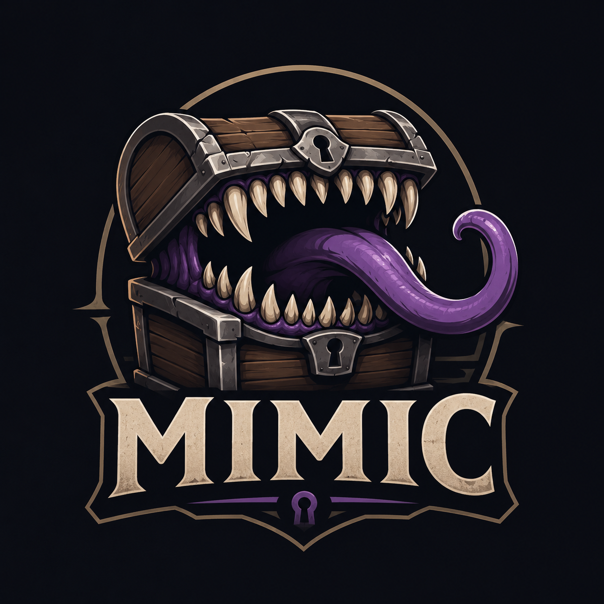

<p align="center">
  
</p>

# Mimic

A lightweight platform that simulates third-party providers used by GolgiMed — for local development, integration testing, and CI, when you don't have (or don't want to depend on) real sandbox access.

Looks like the real provider. Bites different.

It emulates provider HTTP contracts, state transitions, and webhooks with predictable, configurable behavior. It is **not** a production system, and it does not try to reproduce every detail of the real providers — see [CLAUDE.md](CLAUDE.md) for the project's design philosophy.

Third-party provider sandboxes are often unavailable, incomplete, slow, rate-limited, or difficult to reproduce consistently in CI. Mimic provides a deterministic local replacement that behaves enough like the real provider for integration testing.

## Why Mimic?

When integrating with third-party providers, you usually have three options:

| Approach | Good for | Limitations |
|----------|----------|-------------|
| Unit-test mocks | Testing your own business logic | Doesn't validate HTTP contracts, retries, webhooks, or integration behavior |
| Provider sandbox | End-to-end validation | Can be slow, unavailable, rate-limited, incomplete, or difficult to automate |
| Mimic | Local development, integration tests, and CI | Simulates the provider rather than being the provider itself |

Mimic exists to fill the gap between mocks and real providers.

It behaves like an external service, exposing the same HTTP endpoints, payloads, asynchronous processing, state transitions, and webhooks, while remaining deterministic, fast, and entirely local.

This lets you:

- develop integrations offline;
- run integration tests in CI without external dependencies;
- reproduce provider failures on demand;
- debug webhook flows deterministically;
- test retry and recovery logic without modifying application code.

Use mocks to test your code.
Use Mimic to test your integration.
Use the real provider to validate production behavior.

## Architecture

Mimic is a multi-provider platform: the core knows nothing about any individual provider's business rules, and adding a new provider requires no changes outside that provider's own directory.

```
cmd/mimic/
    main.go             # entrypoint: wires storage/providers/admin, hands lifecycle to Lane

internal/
    registry/
        registry.go      # Provider type + in-memory registry (Register/Get/All/Enabled)

    core/
        mux.go            # builds the root http.ServeMux, CORS, /health, /dashboard

    openapi/
        loader.go          # parses OpenAPI 3.x specs from specs/
        provider.go         # turns parsed specs into a registry.Provider
        ...

    providers/
        providers.go      # registers every known provider
        zenvia/
            README.md      # provider-specific docs
            provider.go     # Provider{Name, Register(mux), ListItems, GetItemDetail}
            routes.go
            handlers.go
            state.go
            ...
        integraicp/
            README.md
            provider.go
            ...
        sncr/
            README.md
            provider.go
            ...
        bryscad/
            README.md
            provider.go
            ...

    shared/
        auth/              # reused by 2+ providers
        faults/
        scheduler/
        storage/
        webhooks/
        admin/             # fault injection + dashboard aggregation, provider-agnostic

db/migrations/            # SQL migrations, embedded into the binary via go:embed
dashboard/                 # static dashboard HTML, embedded into the binary via go:embed
specs/                    # user-dropped OpenAPI specs, served by internal/openapi
```

Each provider owns its routes, request/response payloads, state transitions, and webhook events. `internal/core` only builds the HTTP mux, loads configuration, registers enabled providers, and exposes shared infrastructure (logging, scheduling, storage, webhook dispatcher, fault injection). Server lifecycle — concurrent startup, SIGINT/SIGTERM handling, health checks, graceful shutdown — is handled by [Lane](https://github.com/rluders/lane). Shared modules under `shared/` only exist because they're reused by more than one provider — nothing there knows a provider's business rules.

### Provider registration

A provider is a `*registry.Provider` (see `internal/registry/registry.go`):

```go
type Provider struct {
    Name          string
    Register      func(mux *http.ServeMux)       // mounts routes, e.g. under /zenvia/...
    ListItems     func() []DashboardItem          // optional: feeds the dashboard
    GetItemDetail func(id string) (*ItemDetail, bool)
}
```

`internal/providers/providers.go` registers every known provider into the registry. `internal/core` mounts only the *enabled* ones (see Configuration below).

### Adding a new provider

1. Create `internal/providers/<name>/` with routes, handlers, state, and a `README.md` documenting its endpoints and known limitations.
2. Add a `provider.go` exposing a `New(...) *registry.Provider` constructor (see above).
3. Register it in `internal/providers/providers.go`.
4. No other file needs to change — the core, admin dashboard, and fault injection pick it up automatically.

## Supported providers

- **[Zenvia](internal/providers/zenvia/README.md)** — SMS, WhatsApp, and Email messaging, with subscription-based delivery-status webhooks.
- **[IntegraICP](internal/providers/integraicp/README.md)** — Brazilian digital signature / ICP-Brasil certificate flows.
- **[SNCR](internal/providers/sncr/README.md)** — ANVISA's controlled-prescription numbering allocation service.
- **[BRy SCAD](internal/providers/bryscad/README.md)** — BRy SCAD digital signature collections (all 54 operations of BRy SCAD API REST v1).
- **[CRM](internal/providers/crm/README.md)** — CFM Consulta Médicos SOAP web service (operations Consultar and Validar, official WSDL), with fixtures for regular and non-regular registrations.
- **[OpenAPI adapter](specs/README.md)** — drop any OpenAPI 3.x spec into `specs/` and Mimic serves it as a mock provider (route prefix derived from the spec title, optional CRUD persistence), no hand-written code required.

See each provider's README for endpoint-level usage and known limitations.

**Not simulated (no official contract):** CFO/CRO (dentists), CFF/CRF (pharmacists) and CFMV/CRMV
(veterinarians) publish no documented machine-to-machine registration lookup. Their public lookups are web UIs
(CFO and CFMV behind reCAPTCHA), and CFF's WSCFF is login-only with no public documentation. They will be added
only once an official contract is available.

## Requirements

- Go 1.26+
- Docker + Docker Compose (optional, for containerized runs)

## Getting started

```bash
go run ./cmd/mimic
```

The server listens on `http://localhost:3000` (`PORT` env var to change it). State is a local SQLite file at `db/simulator.sqlite`; delete it to reset. Migrations and the dashboard are embedded in the binary — nothing else needs to be on disk to run it.

Or with Docker:

```bash
docker compose up --build
```

To also serve OpenAPI specs (see [Supported providers](#supported-providers)), use the `serve` subcommand:

```bash
go run ./cmd/mimic serve
```

With no flags, `serve` looks for a `specs/` directory and loads every spec found there. Flags:

| Flag | Purpose |
|---|---|
| `-spec-dir <path>` | Recursively scan a directory for spec files instead of `specs/` |
| `-spec <glob>` | Load spec files matching a glob pattern (repeatable) |
| `-conflict <mode>` | Route-prefix conflict handling across specs: `strict` (default), `merge`, or `priority` |

See [specs/README.md](specs/README.md) for spec discovery, route-prefix derivation (`x-mimic-name`), CRUD persistence (`MIMIC_OPENAPI_PERSIST`, `x-mimic-persist`), and request validation (`MIMIC_OPENAPI_VALIDATION`, `x-mimic-validation`).

## Usage

Every endpoint mirrors its real provider's relative path and payload shape as closely as reasonably possible, so a client built against the real API works against the simulator with only its base URL changed. See each provider's README (linked above) for concrete request examples.

## Dashboard

`GET /dashboard` — a single page listing everything the simulator has processed across enabled providers, newest first. Click a row for its raw payload and webhook delivery log.

The "Flush" button (`POST /admin/flush`) wipes every table's data (items, faults, webhook logs) while keeping the schema, so you can reset state between test runs without restarting the server.

## Timeline

Every simulated interaction is recorded as an ordered event log: `RequestReceived`, `ResponseReturned`, `ResourceCreated`, `StateChanged`, `JobScheduled`/`JobStarted`/`JobCompleted`/`JobFailed`, `WebhookDelivered`/`WebhookFailed`/`WebhookDropped`, and `FaultApplied`. Read it with `GET /admin/timeline` (filters: `request_id`, `provider`, `resource_id`, `limit` — default 500, newest kept, returned oldest first), from the dashboard's **Timeline** button, or per resource in the dashboard's item detail. Control-plane calls (`/admin`, `/dashboard`, `/health`) are not recorded, and Flush clears the timeline.

```bash
curl "http://localhost:3000/admin/timeline?provider=zenvia&resource_id=<message-id>"
```

### Correlation IDs

Every simulated request gets a request ID — the client's `X-Request-ID` if it is 1–128 visible ASCII characters, otherwise a fresh UUID — returned in the `X-Mimic-Request-ID` response header. The ID follows everything the request causes, including asynchronous work: scheduled jobs (stored on the `jobs` row and restored when the job runs), state transitions, webhook deliveries (stored on `webhook_deliveries` and sent as an `X-Mimic-Request-ID` header on the outgoing webhook), timeline events and scheduler logs (`request_id` attribute). To see everything one request caused:

```bash
curl "http://localhost:3000/admin/timeline?request_id=<X-Mimic-Request-ID>"
```

In the dashboard, click a request ID in any timeline.

## Simulations and seeds

Every simulated request runs inside a **simulation**, which owns a seed. Every random decision Mimic makes in it — fault `probability` rolls, `delayDistribution` latency samples, generated ids and fake values for persisted OpenAPI resources — draws from a stream derived from that seed. The same requests, in the same order, under the same seed and configuration therefore behave the same way, including in the scheduled jobs and webhooks they cause.

```bash
# Create a simulation (omit "seed" to have one generated and returned)
curl -X POST http://localhost:3000/admin/simulations -d '{"seed": 847291}'
# → {"id":"sim_…","seed":847291,…}

# Run requests in it
curl http://localhost:3000/zenvia/subscriptions -H "X-API-TOKEN: t" -H "X-Mimic-Simulation: sim_…"
```

- Select a simulation per request with `X-Mimic-Simulation`. Without it, the request runs in its own fresh *implicit* simulation with a generated seed. Every response reports the active simulation in `X-Mimic-Simulation-ID` and `X-Mimic-Seed`, so a failure seen once can be re-run under the same seed.
- An unknown `X-Mimic-Simulation` is rejected with `400 UNKNOWN_SIMULATION`.
- `GET /admin/simulations` lists explicit simulations (`?implicit=true` includes implicit ones), and `GET /admin/simulations/{id}` shows one. `GET /admin/timeline?simulation_id=…` shows everything that happened in one.
- A scheduled job runs in the simulation of the request that scheduled it.
- Values that stay non-deterministic: provider-assigned UUIDs such as Zenvia message ids, BRy collection keys and webhook event ids, plus wall-clock timestamps. They identify resources rather than drive behavior.

## Scenarios

A **scenario** names one provider behavior: the state path a resource follows and when, the webhooks that emits, and any faults that apply. Scenarios are declared next to each provider (`internal/providers/<provider>/scenarios.yaml`). They configure behavior around the provider's own routes and state model; they don't change the API contract. Pick one when creating a simulation:

```bash
curl http://localhost:3000/admin/scenarios        # catalog: name, provider, lifecycle, webhooks, faults
curl -X POST http://localhost:3000/admin/simulations -d '{"scenario": "message-not-delivered", "seed": 1}'
# then send requests with X-Mimic-Simulation: <id>
```

- Resources created in that simulation follow the scenario's path instead of the provider's default. A transition without `after` uses the provider's default delay (e.g. `ZENVIA_STATUS_DELAY_MS`). Scheduled jobs keep following the scenario, because they run in the simulation.
- A scenario's `faults` are created scoped to that simulation, so they hit only its requests and other traffic is unaffected. They show up in `GET /admin/faults` with a `simulationId`.
- Without a scenario, providers behave exactly as before.

## Profiles

A **profile** is a preset for *how* a simulation runs: timing, latency and failure rate. Providers and scenarios still decide *what* happens. List them with `GET /admin/profiles`, set a default with `MIMIC_PROFILE`, or pick one per simulation:

```bash
curl -X POST http://localhost:3000/admin/simulations -d '{"scenario":"message-delivered","profile":"fast","seed":1}'
```

| Profile | Transition delays | Added request latency | Failures |
|---|---|---|---|
| `fast` | ×0 (due immediately) | none | none |
| `realistic` | ×1 | normal, mean 150ms, sd 50ms | none |
| `chaos` | ×2 | uniform 50–1500ms | 10% of requests → `503` |

Precedence, highest first:

1. An explicit fault matching a request, from `PUT /admin/faults` or the scenario's faults, replaces the profile's latency and failure roll for that request.
2. A scenario step's `after`, or the provider's configured default delay such as `ZENVIA_STATUS_DELAY_MS`, sets the base transition delay. The profile scales that base.

Profile decisions draw from the simulation seed, so they are reproducible. The effective profile is stored on the simulation (`GET /admin/simulations/{id}`). Profile-caused failures appear on the timeline as `FaultApplied` with `"source": "profile:chaos"`. Without a profile, behavior is unchanged.

## Simulation time

Everything time-based in a simulation — scheduled jobs and state-transition delays (e.g. `ZENVIA_STATUS_DELAY_MS`), token expiry, rate-limit windows, provider timestamps, timeline timestamps and simulated latency — reads a simulation clock instead of the system clock:

- `MIMIC_CLOCK=realtime` (default): simulation time is wall-clock time. Behavior is unchanged.
- `MIMIC_CLOCK=accelerated`: simulation time runs `MIMIC_CLOCK_SPEED` times faster (default 60, so one real second is one simulated minute). Latency faults sleep proportionally less.
- `MIMIC_CLOCK=virtual`: simulation time stands still until you advance it. Advancing runs every scheduled job that falls due on the way, in due-time order, with the clock set to each job's due time, so a whole lifecycle can be fast-forwarded in one call. Latency faults don't sleep.

```bash
curl http://localhost:3000/admin/clock                      # {"mode":"virtual","now":"…"}
curl -X POST http://localhost:3000/admin/clock/advance -d '{"duration":"24h"}'
```

Advancing a realtime clock returns `409 REALTIME_CLOCK`. The scheduler still polls every `SCHEDULER_INTERVAL_MS` of real time. The `created_at`/`updated_at` bookkeeping columns written by SQLite stay on wall-clock time; they record when Mimic stored a row, not simulated time.

## Fault injection

Simulate failures without touching code:

```bash
curl -X PUT http://localhost:3000/admin/faults -H "Content-Type: application/json" \
  -d '{"provider":"zenvia","routePattern":"/zenvia/channels/sms/messages","faultKind":"http_status","faultValue":"503"}'
```

Kinds: `delay_ms`, `http_status`, `timeout`, `invalid_payload`, `webhook_dropped`, `webhook_invalid`, `rate_limited`. Omit `routePattern` to apply to every route for a provider; add `"times": N` to auto-clear after N uses, `"probability": 0.3` to fire only some of the time, or `"delayDistribution"` for jittered latency (`{"kind":"uniform","minMs":50,"maxMs":300}` or `{"kind":"normal","meanMs":100,"stdDevMs":20}`). `GET /admin/faults` lists active faults, `DELETE /admin/faults/:id` clears one.

## Configuration

| Variable | Default | Purpose |
|---|---|---|
| `PORT` | `3000` | HTTP port |
| `DB_PATH` | `db/simulator.sqlite` | SQLite file path |
| `LOG_LEVEL` | `info` | Logger level |
| `DEFAULT_DELAY_MS` | `0` | Baseline simulated processing latency |
| `SCHEDULER_INTERVAL_MS` | `1000` | Background job poll interval |
| `MIMIC_PROVIDERS` | *(all registered)* | Comma-separated list of provider names to enable, e.g. `zenvia,integraicp` |
| `MIMIC_OPENAPI_PERSIST` | `false` | Enable real CRUD persistence for spec-mocked routes (see [specs/README.md](specs/README.md)) |
| `MIMIC_PROFILE` | _(none)_ | Default simulation profile: `fast`, `realistic` or `chaos` (see [Profiles](#profiles)) |
| `MIMIC_CLOCK` | `realtime` | Simulation time: `realtime`, `accelerated` or `virtual` (see [Simulation time](#simulation-time)) |
| `MIMIC_CLOCK_SPEED` | `60` | Simulated seconds per real second when `MIMIC_CLOCK=accelerated` |
| `MIMIC_OPENAPI_VALIDATION` | `permissive` | `strict` rejects requests that violate a spec's contract with 400; `permissive` serves them with an `X-Mimic-Validation-Warning` header (see [specs/README.md](specs/README.md)) |

Provider-specific variables (e.g. `ZENVIA_STATUS_DELAY_MS`) are documented in each provider's README.

### Enabling/disabling providers

By default every registered provider is enabled. To run only a subset:

```bash
MIMIC_PROVIDERS=zenvia go run ./cmd/mimic
```

or in `.env`:

```
MIMIC_PROVIDERS=zenvia,integraicp
```

## Testing

```bash
go vet ./...
go test ./...
```

Integration tests spin up the app in-process (`net/http/httptest`) against an in-memory SQLite database (`tests/`).

## Limitations

- **OpenAPI specs are parsed with [kin-openapi](https://github.com/getkin/kin-openapi).** Local `$ref`s (`#/components/...`) are resolved at load time; external (file/URL) `$ref`s are rejected so a spec never triggers network or filesystem access. An unresolvable `$ref` or unparseable document fails the load with an error naming the file; OpenAPI schema-conformance problems (e.g. a missing response `description`) are logged as warnings and the spec still loads. Schema-generated bodies merge `allOf` members and use the first `oneOf`/`anyOf` alternative.
- **CRUD persistence only covers single-level resources.** A collection route with zero path parameters (`/pets`) or an item route with exactly one trailing path parameter (`/pets/{id}`) is inferred as CRUD. Nested resources (`/pets/{id}/vaccinations`) or routes with multiple path parameters keep static example/stub behavior regardless of `MIMIC_OPENAPI_PERSIST`. See [specs/README.md](specs/README.md).
- Mimic is not a production system and doesn't try to reproduce every detail of a real provider — see [CLAUDE.md](CLAUDE.md) for the design philosophy behind that tradeoff.

## Roadmap

- Everything else is driven by whatever new provider or simulation need comes up next — see [CLAUDE.md](CLAUDE.md)'s "Adding a new provider" section if you want to contribute one.

## Contributing

Contributions are welcome — see [CONTRIBUTING.md](CONTRIBUTING.md) for how to build, test, and submit changes, and [CLAUDE.md](CLAUDE.md) for the project's design philosophy (what Mimic is and deliberately isn't).

## License

Apache License 2.0 — see [LICENSE](LICENSE).
